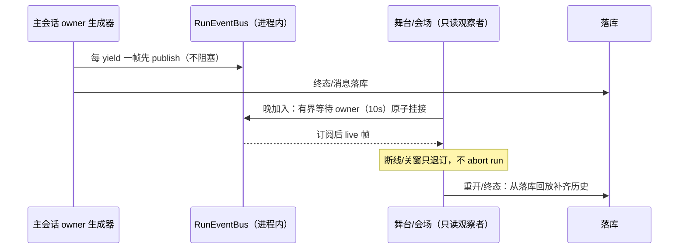

# WorkBuddy v1.9 版本总结：有舞台——多智能体可视化会议舞台

## 1. 主题与价值主张

v1.4 的多智能体协作一直以「工位式泳道」呈现：状态卡片、证据列表、交接记录——信息完整但不可围观。v1.9 把协作与讨论搬上**看得见的舞台**：Live2D 角色站位、聚焦、口型与台词，同时新增由用户主持的**多助手会议**（2–4 位助手围绕同一议题串行讨论）。

整版有一条不变的架构红线：**舞台永远只是渲染器**。它不新增任何执行权限、不改变协作 run 的状态机、不持有队列生命周期——协作与会议的队列所有方始终在 web 主会话，关舞台窗不退协作、不退会议。

## 2. 交付清单（按里程碑）

| 里程碑 | 提交 | 出口 |
|---|---|---|
| M0 冻结 | `b8c8912` | 多实例 Live2D 真机性能 spike（方案 A 三实例同活达标/方案 C 仅发言者活留作省电档）、cast 与舞台只读渲染协议、会议防串角协议三篇冻结稿 |
| M1 舞台骨架 | `4eef0ca` | 三槽站位/聚焦/台词/名字牌/自定义场景背景、Electron 独立舞台窗（与桌宠互斥）、帧率看门狗自动省电降级、场景 CRUD + 背景上传（v027 迁移） |
| M2 协作 run 适配器 | `eda8bd0` | 真实协作「在舞台观看」：进程内事件总线 + 有界等待挂接 + 终态回放；舞台零执行控件，关窗不杀 run；409 退避重连/断线续看 |
| M3 多助手会议 | `3708d01` | manual/all/auto 三调度、防串角三段协议、单请求单 abort、四席舞台只读参会、v028 迁移、备份 schema v5、反向 eval |
| M4 封版 | `246ca6d`（tag `v1.9.0`） | 版本号 1.9.0、全量门禁、Windows 安装包真机抽测、GitHub Release |

**M0 冻结的两份协议是整版没返工的关键**：cast/舞台协议锁死了「舞台只消费 StageDirection、帧→指令纯映射」的形状；防串角协议锁死了会议的请求形状、归属口径与四种非法提名的拒绝规则，M1–M3 只消费契约。

## 3. 核心机制

### 3.1 舞台只读渲染：一切皆 StageDirection

舞台层不认识协作 run 也不认识会议，它只消费统一的 `StageDirection`（cast/focus/motion/speech）。两个适配器都是纯函数：

- **协作适配器**：agent SSE 帧 → 聚焦 + thinking/working/listening 微动作；handoff 帧转源角色一句短台词并转移焦点；executor 的工具流不念白、只挂 working；谢幕/失败用语言中立固定文案。
- **会议适配器**：turn 帧聚焦当前发言者（其余人 listening）、delta 帧驱动口型台词、message 落库帧收口；渲染归属只采信帧里的 `speakerId`，正文里的「我是 XX」一律不解析。

角色形象解析顺序：场景逐槽覆盖 → 全局设置 → 内置 haru 回落。舞台不建音频管线，主窗唯一 AudioContext，舞台只收电平/状态中继做口型。

### 3.2 第二客户端观察：进程内事件总线

v1.4 原有 SSE 是「单订阅者拥有生命周期」模型，主会话断线即 abort run。舞台是只读第二客户端，为此新增进程内 fan-out 总线：

会议是长连跨多轮场景，总线缓冲设上限 200 帧（只兜订阅瞬间积压），历史永远由落库回放补齐，避免长跑内存膨胀。会议执行在 `POST /turns` 后异步进行，不绑 SSE 生命周期。

### 3.3 会议防串角三段协议

每次模型调用都满足：

1. **system 段**：身份规则（「带 `[助手·X]` 前缀的是别人说的，你只能代表 X 发言」）+ 近 20 条带标注转录（用户行 `[用户·X]`、助手行 `[助手·X]` 严格区分）+ **仅当前发言成员自己的角色卡**（绝不注入他人卡，防模仿人格）；
2. **请求恒为 `[system, user]`**：每轮从落库转录重建，永不制造假的多轮 assistant 消息；manual 的 user 锚点原样（保留 @ 文本），all/auto 包调度指令；
3. **渲染归属只信落库 `speaker_id`**。

三种调度的「下一位发言者」全部由服务端纯函数决定，前端永远不能传自由 speaker id：

| 模式 | 触发 | 收敛 |
|---|---|---|
| manual | 正文 `@成员名`（多人按书写顺序串行）；无 @ 只存用户消息不调模型 | 用户逐轮控制 |
| all | 全成员按席次各一次 | 一轮结束自动回 manual |
| auto | 首位成员后，模型可在回复末尾输出 `{"next_speaker":"成员名"}` 接龙 | 四类提名（非成员/自己/连续同人/第 9 轮）服务端硬拒即收回 manual；硬顶 8 轮 |

成本与跑偏硬限制：成员 2–4、单条发言 200 字（超长截断并标记）、用户单轮 2000 字、发起前 UI 显示预计调用量级。

### 3.4 单请求单 AbortController

同一会议同一时刻只允许一个发言请求：活跃期间重复提交返回 409；打断/结束即 abort 当前模型调用，会议分别收敛为 `aborted`/`finished`，终态后输入与控制按钮禁用。

### 3.5 持久化与备份（schema v5）

- v028 纯加法迁移：`meetings`（议题/席次/模式/共用模型/状态/auto 轮次）+ `meeting_messages`（seq 单会议严格递增）；
- 备份 schema 升到 **v5**：events 轨追加 `stageScenes.json`、`meetings.json`、`meetingMessages.json`，precheck 显示三类计数；恢复全部 `INSERT OR IGNORE` 幂等，悬空成员从 memberIds 剔除，其历史转录凭 speakerName 快照保留并在 UI 标注，v4 旧档缺文件按 0 降级。

## 4. 测试与门禁

- **反向 eval 4 例**（协议 §6）：诱导复读后归属仍是当前成员；正文写「我是 XX」气泡仍显示真实成员；auto 提名非成员被拒并终止接龙；自我提名/连续同人同样拒绝（8 轮硬顶）；外加打断 abort 无悬挂调用、活跃重复提交 409。
- mock 会议接龙协议 `[meeting-chain:名1>名2>名3]`：名单随转录传播驱动确定性接龙，e2e 零外网。
- typecheck 全包绿、ESLint 0 error、手写文件 300 行硬门禁；单测全量绿（core 986 / web 460 / ai 62 等）。
- CI 模式（production build + next start）e2e **72/72**：新增会议 4 例（UI 建会与无 @ 不触发、all 全员一轮、auto 三席接龙 + 舞台回放、长流式中打断）。
- 发布资产经 Windows 真机抽测：静默安装/卸载、内置 Node 直跑 standalone（health 回报 1.9.0、会议与场景 API 正常、原生 sqlite 初始化）、GUI 启动并拉起托管服务（token 401 守卫生效、新库引导 307）。

## 5. 留白与顺延（v2.0 候选）

- **会议结论摘要/待办**（P1）：结束时一次额外 LLM 调用产出结构化结论；本版只做讨论与转录，不自动建任务。
- **时间戳回放 / 观众模式**（P1）：当前终态回放是全量转录重放，无时间轴；观众模式（只读链接围观）涉及鉴权/分享链路，未做。
- 自由 N 角色、角色市场、自发群聊、computer use 上舞台、VRM 三维舞台、手机/网页分享均为 P2，未排期。
- 红线不变：无外部 Live2D 模型导入（Cubism 授权边界）、不捆绑音色包、会议成员无工具/无 MCP/无桌面控制。
