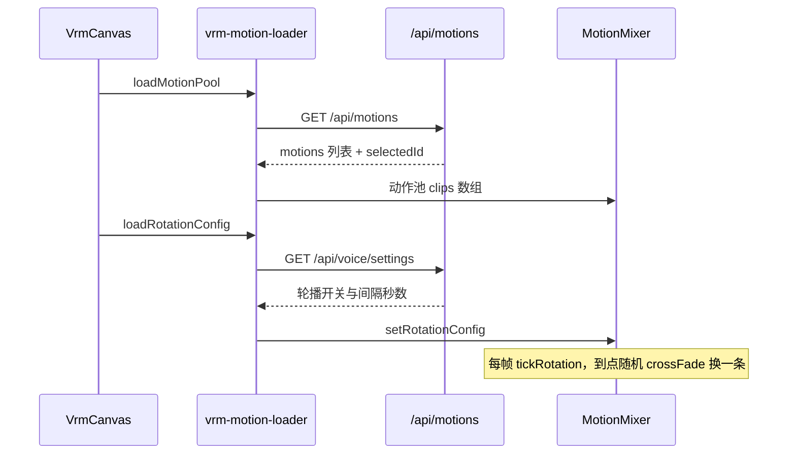
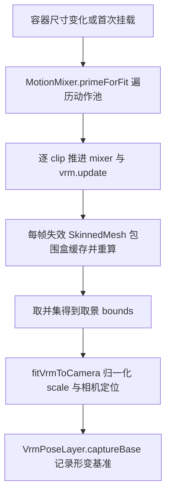
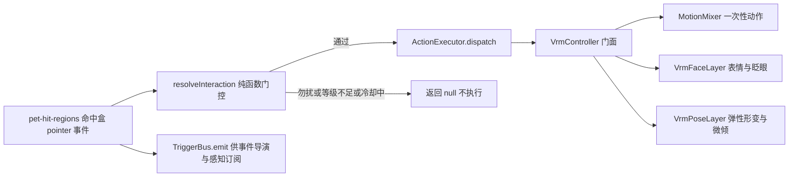

# WorkBuddy v2.1 版本总结：会动——VRM 待机动作与桌宠交互管道

## 1. 主题与价值主张

v2.0 把 3D 形象「放进来」了，但放进来之后是僵的：VRM 规范要求静止姿态是 T-pose，模型本体又不含任何 AnimationClip，于是形象站着不动、点击只有一层弹性形变。v2.1 要回答的是**「形象怎么才算活着」**：

**外部动作可以自己带进来 → 动作池会自己换 → 点在哪儿就演出对应反应。**

三条主线：**待机动作开放**（VRMA 导入向导 + 动作池 + 定时随机轮播 + 点击触发一次性动作）、**桌宠交互管道收口**（配置驱动热区 → Resolver 门控 → ActionExecutor 执行 → TriggerBus 广播）、**新增代码去重与热点拆分**（把本版涨起来的 4 个超 300 行文件拆回去，门禁从红转绿）。

红线不变：本地优先（动作文件只落本机 `data/motions/`）、授权边界（动作与模型都走 GLB 魔数 + 扩展标记双校验白名单通道，必须勾选免责声明才能入库）、不捆绑素材（只提供本地渲染能力，不提供下载）。

## 2. 交付清单（按里程碑）

| 里程碑 | 提交 | 出口 |
|---|---|---|
| M0 稳定化热修 | `87ddb8a` / `aa96f71` / `052398b` / `90507a3` / `c7810bc` | pet-window 漏 import app 的崩溃修复、NSIS 覆盖安装强制清装会话缓存、VRM 文件流支持 URL query token（three.js GLTFLoader 绕不过 Authorization 头）、归档脚本清残留、e2e 先勾选 avatar-enabled |
| M1 桌宠交互管道 | `890bd67` / `089f3ec` / `7ecca43` / `e1df75f` / `84c46b7` / `5d24853` / `415b696` | 交互触发管道骨架 + VRM 三段式状态机；配置驱动热区（head/body tap+longpress）；Resolver 门控（勿扰时段/关系等级/区域冷却）；ActionExecutor 类型清单；EventDirector 桥 + TriggerBus emit + 旧 useHeadTouch 退役；表情残留与 tap 覆盖 longpress 修复；pointer-events 穿透对齐 Live2D |
| M2 待机动作开放 | `d70ecbc`（功能部分） | v032 `motion_assets` + core motion-service（双校验/落盘/增删查）+ `/api/motions` 三个路由 + 设置页导入向导与列表；动作池 = 内置 daiji + 全部已导入动作；定时随机轮播（3–60s，默认 8s）；点击触发一次性动作 |
| M3 去重与热点拆分 | `d70ecbc`（重构部分） | 删死代码；抽 `glb.ts` / `animated-bounds.ts` / `asset-import-section.tsx` / `asset-list.tsx`；4 个超 300 行文件拆到 0 违规 |
| 封版 | `d70ecbc` 后接版本号同步 | 版本号 2.1.0、行数门禁与 ESLint 归零 |

M2/M3 合并为一次功能提交（`d70ecbc`），因为待机动作列表 UI 本身就在用新抽出的通用导入/列表组件，拆开无法独立通过测试。

## 3. 核心机制

### 3.1 待机动作：动作池 + 单 mixer

动作池由 `vrm-motion-loader.ts#loadMotionPool` 组装：读 `/api/motions` 拿到「已导入列表 + 当前选中 id」，把选中项排首位当初始待机，再把内置 `daiji.vrma` 兜底压入池尾（**无论用户导入多少动作，内置动作一定在池里**），并发上限 8 条，任一文件失败只 `console.warn` 跳过。

播放侧是 `vrm-motion-mixer.ts#MotionMixer`：**全应用只有一个 AnimationMixer**。这不是风格选择而是硬约束——两个 mixer 会争抢同一批 normalized humanoid bone，权重无法混合，表现出来就是待机动作被手势动作「打回 T-pose」。因此 `LoopOnce` 的一次性手势也走同一个 mixer，播完靠 mixer 的 `finished` 事件淡回待机；手势播放期间轮播计时直接归零，不打断。

| 能力 | 真实入口 | 实现 |
|---|---|---|
| 定时随机轮播 | `MotionMixer#tickRotation` | 池内随机挑一个 ≠ 当前的 clip，`reset → play → crossFadeTo(…, 0.4, warp)` |
| 点击播一次性动作 | `VrmController#tap` → `MotionMixer#playRandomGesture` | `setLoop(LoopOnce, 1)` + `clampWhenFinished`，`finished` 后 `returnToIdle` |
| 池空回退 | `VrmController#tap` | 退回模型内嵌 tap clip / 程序化微倾 + 眨眼 |
| 轮播配置 | `motionRotationEnabled` / `motionRotationSeconds` | `packages/shared/src/schemas/voice.ts`，越界回落 8s，设置页复用 voiceSettings PATCH |

### 3.2 取景：为什么必须采「整个动作池」

换成多动作轮播后，取景 scale 的来源从「一段待机动画的包围盒并集」变成「**动作池每一条 clip 的并集**」。否则轮到摆幅更大的动作时，按小动作算出的 scale 会把四肢裁出视锥。

两个真实踩坑（都在本版修掉）：

1. three.js 的 `Box3.setFromObject` 对 Mesh/SkinnedMesh **只在 `boundingBox === null` 时才 `computeBoundingBox()`**，否则直接复用缓存。逐帧采样必须先置空缓存，否则永远拿到第一帧的旧盒——实测未修复时采样宽度只有 `0.587`，修好后是 `1.089`。这段「失效缓存 + 重算」现在抽在 `animated-bounds.ts`，被 `primeForFit` 与 `fitVrmToCamera` 兜底分支共用。
2. `fitVrmToCamera` 必须**幂等**（容器尺寸变化会重复调用）：先把 `scale/position` 归零再测量，且对齐与相机定位全部基于传入 bounds 推导。采样帧则按 clip 时长占比分配，总帧数上限 900，避免导入很多长动作时启动卡顿。

### 3.3 桌宠交互：门控前置的配置驱动管道

交互不再是「在一个盒子里写一堆 if」，而是**归一化 → 门控查表 → 执行 → 广播**四段：

- 门控维度全部落在 `packages/shared/src/schemas/interaction-resolvers.ts` 的纯函数里：**勿扰时段**（23:00–06:00，仅放行 `system.voice-end`）、**关系等级**（陌生人不可长按头部、不可提起，`raised`/`pinch` 需搭档以上）、**区域冷却**（head 500ms / body 800ms / raised 1500ms）。
- 动作模板表 `ACTION_TABLE` 键是 `touch::<region>::<gesture>`，值产出 `ActionChain`（`priority` + `cooldownMs` + `actions[]`）；本版给 head/body 的 tap 链各加了一条 `controller.tap`，于是「点击」第一次真正能驱动一次动作演出。
- 执行侧 `ActionExecutor` 支持 `interaction.start/end`、`controller.playSquash/flashExpression/tap/setExpression`、`subtitle.show`、`event.fire`（未实现，仅告警）、`chat.request`（未实现）。

### 3.4 导入链路：一份通用向导，两类资源

VRM 模型与 VRMA 动作的导入流程（扩展名/体积校验 → 本地读 GLB JSON chunk 嗅探元数据 → 免责声明确认 → 上传 → 失效列表缓存）完全同构，本版抽成 `asset-import-section.tsx`（泛型 config：`i18nPrefix` / `testIdPrefix` / `extension` / `maxBytes` / `endpoint` / `queryKey` / `sniff` / `renderMeta` / `pickName` / `buildForm`）与 `asset-list.tsx`（只负责卡片外壳与行布局，查询与删除 mutation 留在调用方），4 个原组件全部退化为薄包装。

服务端是两条独立链路（有意不泛型化）：`motion-service.ts` 校验 `VRMC_vrm_animation` 扩展、落 `data/motions/`、登记 v032 表；`vrm-avatar-service.ts` 校验 `VRMC_vrm`/`VRM` 扩展、落 `data/vrm-avatars/`、登记 v030 表。两者共用新抽的 `glb.ts`（`isGlbContainer` / `readGlbJson` / `readExtensionsUsed`），语义保持 `not_glb` / `parse_failed` / `not_*_extension` 三态不变。

| 路由 | 方法 | 说明 |
|---|---|---|
| `/api/motions` | GET | 已导入动作列表 + 当前 `idleMotionId` |
| `/api/motions` | POST | multipart 上传（非 multipart 直接 422），成功 201 |
| `/api/motions/:id` | GET / DELETE | 单条详情 / 删除并回收文件 |
| `/api/motions/:id/file` | GET | 文件流，`id` 兼容数据库 id 与 fileRef，供 GLTFLoader 直取 |

### 3.5 热点拆分：门禁从 4 处违规到 0

本版把三个文件写胖了（`vrm-controller.ts` 740 行、`vrm-canvas.tsx` 419 行、`pet-stage.tsx` 404 行），全部超出门禁红线，按「只搬代码、不改逻辑」的方式拆开：

- `vrm-controller.ts` → 只剩门面与每帧编排，按行为轴外迁出 `MotionMixer`（动作池/轮播/手势/取景采样）、`VrmFaceLayer`（常驻表情 + 临时表情 + 口型 + 眨眼）、`VrmPoseLayer`（弹性形变 + 头部叠加 + 呼吸微摆）、`VrmInteractionState`（三段式 `A_Start → B_Loop → C_End` 阶段机）。顺带把原本两份字面同构的 `applyExpressionLayer` / `applyExpressionNow` 合并成一份。
- `vrm-canvas.tsx` → 外迁 `vrm-motion-loader.ts`（动作池与轮播配置）与 `vrm-fit.ts`（`fitVrmToCamera` + 自检结果）。
- `pet-stage.tsx` → 两个命中盒实体外迁 `pet-hit-regions.tsx`，舞台组件只留接线与合成；顺带删掉一个从未使用的 `isPetBodyPoint` import。
- `packages/shared/src/schemas/index.ts` 是纯 re-export 的域 barrel（304 行），按白名单「barrel 聚合」登记，不拆分。

## 4. 测试与门禁

- `pnpm typecheck` 14/14 全绿；`pnpm lint:boundaries` **0 error / 64 warning（历史存量）**；`node scripts/check-file-lines.mjs` 通过（>300 行违规 4 → 0，白名单 1 → 2 条）。
- `pnpm test:unit` 14 包全绿：web 90 文件 478 用例、database 30 文件 93 用例、core 15 文件 90 用例、desktop 6 文件 45 用例、shared i18n 3 文件 35 用例。本版新增测试 2 个文件 9 用例（`motion-service.test.ts` 7 + `v032-motion-assets.test.ts` 2）。
- 真机 CDP 实测（Electron dev + 已导入模型与动作）：对话页侧栏 255×643 与桌宠窗 262×342 两个尺寸下，**动作池每条 clip 的逐帧世界包围盒都落在视锥内**、待机动作按 8s 间隔在两条 clip 间切换、点击身体真实触发一次性动作并在播完后自动回待机、设置页 6 个目标 testid 全部挂载。

## 5. 留白与衔接

- **动作池上限 8 条**：并发加载与取景采样都按 8 条封顶，导入更多动作时超出部分不参与轮播（不影响「设为待机」）。
- **动作元数据只读动画条数与时长**：VRMA 没有许可字段，`extractVrmaMeta` 不臆造；导入向导不提供动作改名/备注编辑（表里留了 `source` / `note` 列）。
- **手势种类仍以 tap/longpress 为主**：`TouchGesture` 已含 `double` / `swipe` / `release`，但 Resolver 只覆盖 tap/longpress；双击目前是「回主窗」的窗口行为，不是角色动作。
- **三段式 `interactionKind` 只写不读**：状态里存了交互类型但从没有消费方，作为后续按类型分派动作链的接口预留。
- **`event.fire` / `chat.request` 两类 action 未实现**（执行器里显式告警/跳过），事件导演联动留在 v2.2。
- 下一版（v2.2）以**桌宠交互效果**为主，借鉴 VPet 的动画图与状态机思路：把「区域 → 动作链」升级为可配置的动画图（`GraphType → 动画段 → 条件触发`），并补上拖拽物理（惯性/抛掷/贴边）与按状态挑选待机动作的能力。方案的**生效口径是「策略通用 + 执行 VRM 优先」**：手势/门控/拖拽物理两个后端同时受益，段调度与状态分档先落 VRM——详见 `docs/plan/v2.2/README.md` 第 2 节。

## 6. 安装包归档

本版**未在本机出包**：tag `v2.1.0` 推送后由 Windows 发布流水线（run `39039793572`，`Windows NSIS 安装包` 6m2s 全绿）构建 NSIS 安装包，并以 **draft Release** 形式挂载产物。流水线内先做「tag 必须等于 root package.json version」与 `sync-version --check` 两道一致性校验，再跑单测并构建，最后做产物自检（版本资源/图标，未配证书时跳过签名链校验）。

| 文件 | SHA256 |
|---|---|
| `WorkBuddyForMe-Setup-2.1.0.exe`（139.14 MB） | `9c1f8defe38640557ef80718a4c920d0dceb608369fb1dc9a38a212ea279137f` |
| `WorkBuddyForMe-Setup-2.1.0.exe.blockmap` | `225c8d8ee932d061ac77877beabd9b4666f01d58544ee8eb3c9e6640503749c3` |
| `latest.yml` | `663be997d10c421264ff70f652c490b2580176d8296d7dfc755487a6130ca2c4` |

校验和取自 GitHub Release 资产自带的 `digest`（sha256），**非本地计算**。Release 当前仍为 **draft**，人工核对后转正式；本地归档（`pnpm archive:win`）可在下载产物后补做。
