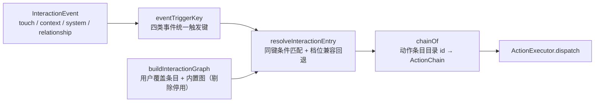
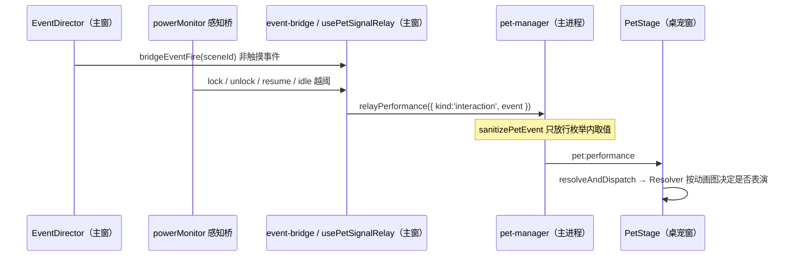

# WorkBuddy v2.2 版本总结：有手感——桌宠反馈升级、交互动画图配置化与事件链接线

## 1. 主题与价值主张

v2.1 把交互管道打通了（归一化 → 门控查表 → 执行 → 广播），但反馈是**扁平的**：按住不放和点一下只差一次表情，待机动作轮流播却和「它现在什么心情」无关，拖拽只有位移、松手就停住。

v2.2 回答的是**「每一次交互怎么才有形状」**：

**按住是有过程的（入场 → 循环 → 退场）→ 待机动作跟着心情与关系走 → 甩出去有惯性、贴边会回正 → 每个反应由一张可配置的动画图决定。**

六条主线：

1. **动片段调度**（仅 VRM）：一个动作条目 = A 入场 / B 循环 / C 退场，按住进 B、松手走 C；
2. **状态驱动的待机动作**（策略通用、候选集 VRM 优先）：情绪档位 + 关系等级分组挑选，向下兼容回退；
3. **拖拽物理与手势**（通用）：速度采样、惯性滑行、贴边回正、双击角色动作；
4. **交互动画图配置化三阶段**（通用）：数据层 → settings JSON 持久化 + 设置页可视化编辑 → 内置条目可覆盖/停用；
5. **事件链接线**（通用）：感知 / 系统 / 关系三类事件接进同一条 Resolver 管道，并补齐系统信号源；
6. **水合门控统一**（工程修复）：11 个「按查询态切结构」的组件补水合门控，消掉 React #418/#422。

红线不变：与后端无关的手势、门控、物理与**配置**两后端共用；需要动作模型配合的段调度与状态分档只落 VRM——**选定 Live2D 形象的用户，行为与本版之前完全一致**（只有手柄变多、拖拽有惯性这两件通用能力可见）。

## 2. 交付清单（按里程碑）

| 里程碑 | 提交 | 出口 |
|---|---|---|
| M0 契约冻结 | `3cdd0dc` | 动作段（`single`/`a_start`/`b_loop`/`c_end`）、情绪档位（`good`/`normal`/`low`）、关系门槛；v033 纯加法迁移；后端作用域（策略通用 + 执行 VRM 优先）写进契约 |
| M1 段调度（VRM） | `fadf573` | `MotionMixer` 升级为动作条目调度器：A→B→C，按住进循环段、松手走退场段，缺段自动退化 |
| M2 状态驱动 | `5ced854` | shared 分组与兼容挑选纯函数（`pickMotionCandidate`/`motionMoodOf`）；关系等级真源修复（IPC 中继，不再是恒「陌生」） |
| M3 拖拽物理与手势 | `b324b23` | 主进程速度采样 + 惯性滑行 + 贴边回正（进入/维持双阈值）；`touch::body::double` 角色动作；按手势独立冷却 |
| M4 收口 | `e59b3ac` / `6e04da8` / `0b69854` | 交付状态与顺延项文档；导入侧标注接线；拖拽四项回归修复（幽灵按下自愈、拖拽幂等、尺寸棘轮、抛掷误触门禁） |
| P1-1a 动画图数据层 | `ca2be33` | `eventTriggerKey` / `resolveInteractionEntry` / `buildInteractionGraph` + 动作条目目录（条目引用 `chainId`，整张图可 JSON 化） |
| P1-1b settings JSON + 可视化编辑 | `19db19b` | `interactionGraphOverrides`（≤50）+ 服务端钳制；设置页「交互动画图」面板（触发键/条件/动作条目可视化编辑，草稿 + 显式保存） |
| P1-1c 内置条目可覆盖/停用 | `9eb9cd1` | 内置条目加稳定 id + `isBuiltinEntryId`；`interactionGraphDisabledEntryIds`；面板内置条目区（启用开关 + 覆盖按钮 + 「已覆盖」标记） |
| P2-2a 事件链接线 | `6b2a2ed` | Resolver 不再只 cover 触摸：四类事件走同一触发键、按事件冷却；勿扰仍只放行 `system.voice-end`；`pet.ts` 新增 `interaction` 中继载荷 + IPC 净化 |
| P2-2b 中继与消费 | `6b2a2ed` | `bridgeEventFire` 把非触摸事件中继到桌宠窗（触摸类不中继，避免与真实触摸双播）；桌宠窗订阅 → 同一条 `resolveAndDispatch` |
| P2-2c 系统信号源 | `88d6361` / `682c312` | `usePetSignalRelay`（语音边沿 + 授权后的锁屏/唤醒/空闲越阈）；非触摸内置条目 4 条（`notice`/`cheer`） |
| 水合修复 | `d246ce9` / `d05ef23` | 调优面板结构不匹配根治；10 个数据驱动面板统一补水合门控 |
| 顺带（同分支） | `9236a43` | 勿扰时段可配置：`DoNotDisturbConfig` + 开关与起止小时设置项（缺省仍 23:00–06:00） |
| 封版 | 本提交 | 版本号 2.2.0（`pnpm sync-version`，root/web/desktop/`shared/version.ts` 四处一致） |

## 3. 核心机制

### 3.1 段调度与动作条目（仅 VRM）

`VrmController` 不再「播一段 clip」，而是**调度一个动作条目**：A 播完自动转 B（循环），B 收到 `setContinue` 延长，C 播完 `finished` 回待机；缺段按顺序退化（缺 A 直接进 B、缺 C 直接回待机）。导入的 VRMA 默认按 `single`（整段即循环段）处理——**不强制用户拆段**，拆段是导入时的可选标注。

### 3.2 状态驱动的挑选（策略通用）

候选集来自各后端（VRM 用动作条目、Live2D 用 motion group），**策略是同一份 shared 纯函数**：情绪档位走「精确 → 更差 → 更好 → 任意」兼容回退，关系等级是**硬门槛**（不够就不给），最终回落 `Default` 组——所以任何状态下都不会「没有可播动作」。

### 3.3 拖拽物理与手势（通用）

速度采样与阻尼在主进程做（渲染进程只上报拖拽事件与最终速度），窗口逐帧 `setPosition`（上限 60Hz）；贴边沿用 VPet 式**双层判定**：进入阈值才开始贴、超出维持阈值就放弃，避免临界抖动。手势侧补齐双击（角色动作，与头部盒「回主窗」的窗口行为分开）与按手势独立冷却（否则双击的第二下会被单击的冷却吃掉）。

### 3.4 交互动画图三阶段（本版重点）

**一条目 = 触发键 + 条件（关系等级 / 情绪档位 / 时段）+ 动作条目 id**；动作链内容仍是代码，条目只引用 id —— 因此整张图可 JSON 化持久化。

三阶段的取舍：
- **数据层**：`buildInteractionGraph(overrides, disabled)` —— 覆盖条目**排在内置图之前**（覆盖优先生效），被停用的内置条目剔除；两者都没有时直接复用内置图（保持引用相等）。**语义守住「查不到返回空」**：停用某触发键的全部条目后，该键匹配为空 —— 这正是「停用」的预期。
- **持久化**：走 `settings_kv` 的 `interactionGraphOverrides` 与 `interactionGraphDisabledEntryIds`，**服务端逐条钳制**（非法触发键、未知动作条目 id、未知内置 id、越界时段一律丢弃并去重），手改 settings_kv 不会污染运行期。
- **可视化编辑**：设置页「交互动画图」面板 = 内置条目区（只读展示 + 启用开关 + 「覆盖」按钮 + 「已覆盖」标记）+ 自定义条目区（触发键四分组下拉 35 键 / 关系等级 / 情绪档位 / 限定时段 / 动作条目）。这块刻意用**本地草稿 + 显式保存**而不是其它面板的即时保存 —— 整表替换数组时逐字段即时保存会在网络往返窗口内互相覆盖。

### 3.5 事件链接线（本版重点）

v2.1 遗留的 `context` / `system` / `relationship` 三类事件此前解析器完全不处理，于是「主动关怀」与「感知」只能走主窗演出，**驱动不了桌宠**。本版把链路补齐：

- **触发键口径**：`touch::<区域>::<手势>` / `context::<触发>` / `system::<信号>` / `relationship::<up|down>`（关系 `delta` 为 0 与对话事件不建键）。
- **门控**：勿扰时段仍然**只放行 `system.voice-end`**；冷却从「按区域」改为「按触发键」（触摸按区域口径、其余 2s 默认），防同一信号连发。
- **系统信号源**（本版新补）：语音状态边沿（`voice-start` / `voice-end`）+ 系统事件感知桥（`lock`→`locked`、`unlock`/`resume`→`wake`、系统空闲**越阈上升沿**→`idle` 一次，30s 轮询样本本身不转发以免刷屏）。系统信号沿用 v2.0 M3 的**显式授权**门控。
- **非触摸默认表现只有 4 条**（`context::longNoChat` / `context::workStreak` → `notice`；`system::wake` / `relationship::up` → `cheer`），其余刻意留空，理由写在代码注释与测试里：`lateNight` 落在默认勿扰射程内（配了也不生效）、`voice-end` 每念完一句都触发会变噪音、`voice-start` 与说话期表情口型打架、`idle`/`locked` 发生时用户看不见屏幕、`relationship::down` 按关系契约「降级不推送、不制造愧疚」不给表现。
- 新增的两条动作条目 `notice` / `cheer` **都不含 `interaction.start`** —— 没人碰它，不该驱动三段式（有单测守这条）。

### 3.6 水合门控统一（工程修复）

`/settings` 上出现 `Did not expect server HTML to contain a 
 in <section>` + 整片 Suspense 边界退化客户端渲染。取证路径：读浏览器控制台日志原文定位到 `TuningPanel`，再拉 SSR HTML 确认它的 `<section>` 子节点是 `[标题 div, Spinner div]` —— 服务端渲染了 Spinner 占位，客户端首帧没有，属**查询态在两帧不一致的结构交换**（React #418/#422）。

修复口径与既有面板（EmotionPanel / EventPanel）一致：**首帧恒与 SSR 一致（只渲染静态标题），挂载后再按数据展开**。随后把同类写法一次性清扫，涉及 `settings-page`（供应商区）、`mcp-panel`、`permission-panel`、`tool-breaker-panel`、`tool-debug-panel`、`skills-panel`、`asset-list`（内容区与 `headerExtra` 一并门控）、`character-cards-panel`、`memory-panel`（筛选栏为本地状态派生、保持可见）、`voice-preference-panel`，共 11 个组件。`defaults-panel` 不改：它的 `draft` 由 effect 赋值，首帧本就与 SSR 一致。

## 4. 测试与门禁

- `pnpm check`：typecheck 14/14、lint 8/8（0 error）、行数门禁通过（所有手写文件 ≤300 行）。
- `pnpm test` 8/8 全绿：**web 94 文件 / 496 例**、shared 29 / 314、core 160 / 1082、desktop 24 / 164、database 52 / 213、ai 12 / 62、voice 7 / 71、config 4 / 14。
- 本版新增测试（本版新增/改动的文件）：`motion-segments`、`vrm-motion-mixer`、`motion-selection`、`interaction-resolvers`（段调度与门控）、`pet-throw-physics`、`pet-throw-controller`、`pet-drag-controller`、`interaction-graph`（触发键/条件/覆盖与停用/分组）、覆盖条目 schema、settings 服务端钳制、`pet` 中继载荷净化、`use-pet-signal-relay`（语音边沿与感知信号）。
- 浏览器实测（真机流程，逐项验收）：交互动画图面板 10 条内置条目（6 触摸 + 4 非触摸，键→条目对应正确）、触发键四分组共 35 键、动作条目下拉 8 项；覆盖条目与停用开关跨刷新持久化；清理后回到默认态；`/settings` 与 `/chat` 全程**无水合相关消息**。

## 5. 留白与衔接

- **真机三尺寸验收未做**（需 Windows + 真实多显示器）：长按三段式手感、甩出去惯性与贴边回正、双击身体角色动作、2D 形象下拖拽惯性同款且其余行为回归无差异。
- **E2E 未在本机执行**（需 Playwright 浏览器与 Electron 打包产物），留待 CI/真机。
- **系统信号的真机验证**：锁屏/唤醒/空闲越阈需要 Electron 桌宠窗 + 真实系统事件，本机浏览器环境覆盖不到；建议连同上面的三尺寸验收一起做。
- **非触摸键多数仍无内置条目**（`context::lateNight`、`system::voice-end`/`voice-start`/`idle`/`locked`、`relationship::down`）：本版按「可感知且不吵」的口径只给了 4 条，其余留给用户在面板里配；`relationship::down` 是否给「安慰」类表现涉及产品口径，需设计确认。
- **P2-1 情绪档位过渡动画**（仅 VRM）仍顺延：需要为内置动作补 `Switch_Up` / `Switch_Down` 过渡段素材，属资源成本。
- **Live2D 侧未做同等能力**：按状态分档的 motion group、长按维持、过渡段都需要重导出 Cubism 资源；2D 用户本版只感知到「手势变多、拖拽有惯性」。
- **对话（`chat`）事件未接**：`ChatEvent` 有意不建触发键（`eventTriggerKey` 返回 null），接入需先定「@助手 / 新消息要不要驱动表演」。

## 6. 安装包归档

本版**未在本机出包**：与 v2.1 同口径，tag `v2.2.0` 推送后由 Windows 发布流水线构建 NSIS 安装包并以 **draft Release** 挂载产物。流水线内先做「tag 必须等于 root package.json version」与 `sync-version --check` 两道一致性校验，再跑单测与构建，最后做产物自检。产物清单与 SHA256 待出包后回填本节（校验和取自 Release 资产自带 `digest`，非本地计算）。
