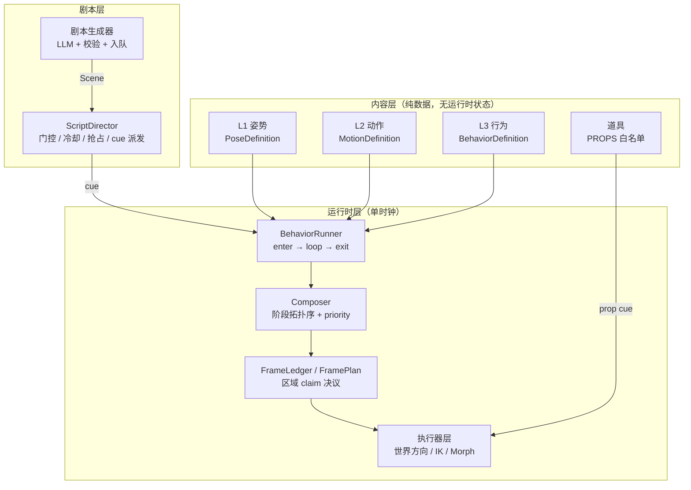
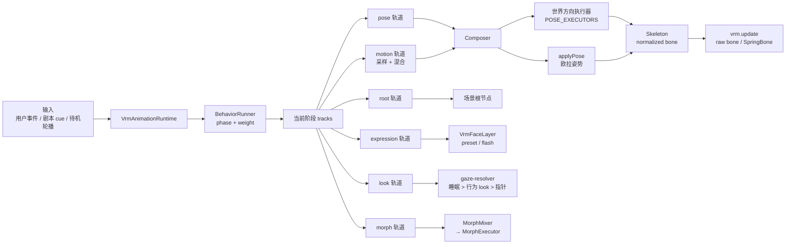
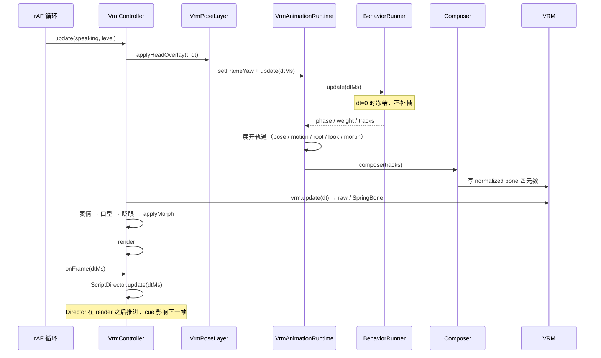
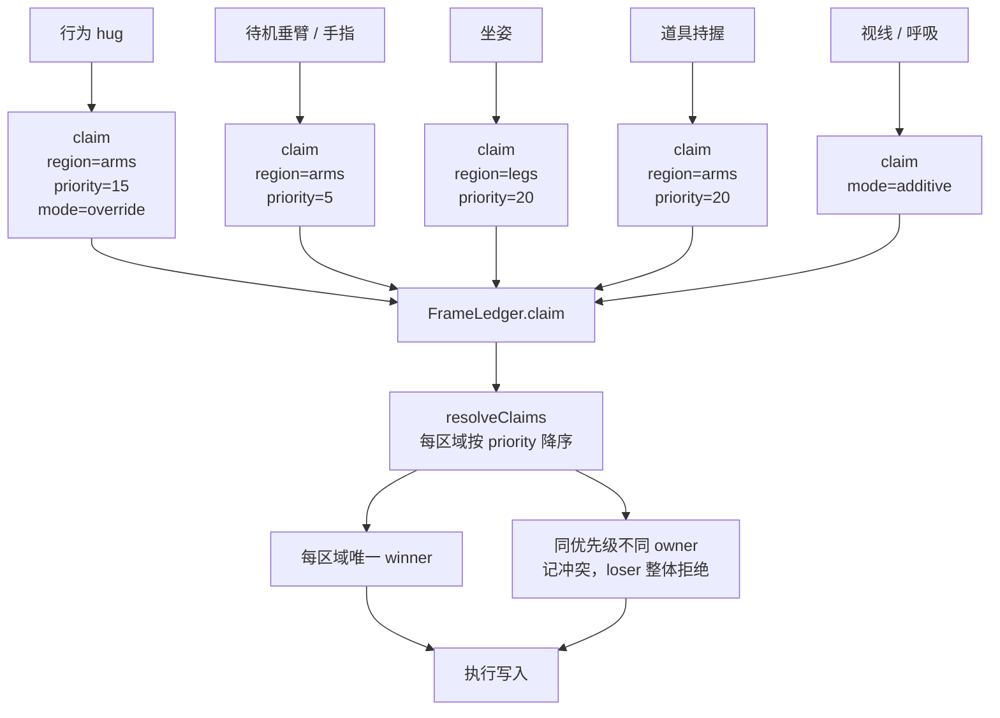
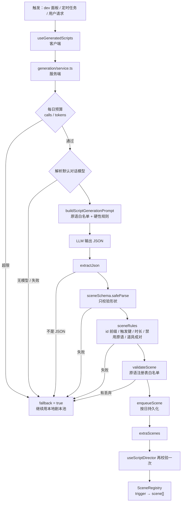
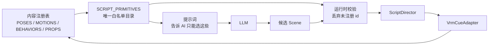
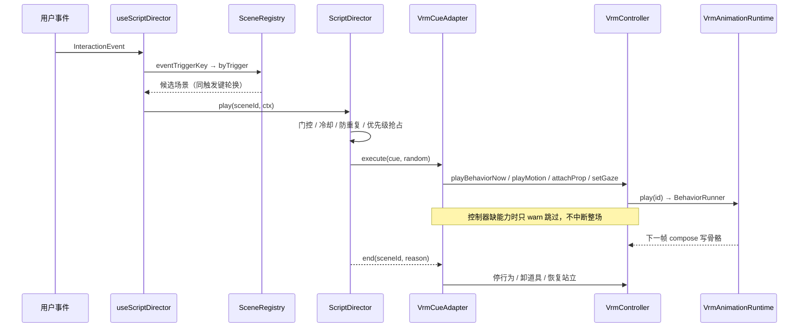

# 动效库与剧情生成器：运行原理与联动

> 定位：知识文档，解释「怎么动」「怎么生成剧本」「两者如何对接」。
> 关联：[README](./README.md)、[plans.md](./plans.md)、[执行路线](../../plan/v3.0/execution-roadmap.md)、[P8 规划](../../plan/v3.0/execution-roadmap.md#p8-ai-剧情推进器p3p6-之后启动)。
> 记录日期：2026-11-13。

## 0. 一句话

- **动效库**回答「怎么动」：把姿势/动作/行为合成为每帧骨骼结果，并保证同一区域只有一个写者。
- **剧情生成器**回答「什么时候、按什么顺序动」：让 LLM 在受限白名单里编排 cue，产出 Scene。
- **两者的连接件**是「原语注册表 + cue 契约」：生成器只能引用注册表里的 id，运行时也只认这些 id。

---

## 1. 总览：三层职责

**读图顺序**：内容层只是 id 与数值；运行时层每帧把 id 展开成骨骼；剧本层不直接写骨骼，只产生 cue。

---

## 2. 动效库运行原理

### 2.1 数据模型：三层内容 + 六类轨道

| 层 | 数据结构 | 职责 | 是否含时间轴 |
|---|---|---|---|
| L1 姿势 | `PoseDefinition` | 命名静态姿态，骨骼 → 欧拉偏移 | 否 |
| L2 动作 | `MotionDefinition` | 关键帧 + 缓动，采样出姿势 | 是 |
| L3 行为 | `BehaviorDefinition` | enter/loop/exit 阶段，组合轨道 | 是（阶段时长） |
| L4 剧本 | `Scene` / `beat` / `cue` | 触发条件 + cue 时间线 | 是（beat.at） |

行为阶段里的轨道共六类：

| 轨道 | 输出 | 消费者 |
|---|---|---|
| `pose` | 骨骼欧拉 | Composer → PoseLibrary |
| `motion` | 采样后的混合姿势 | Composer → MotionLibrary |
| `root` | 整体位移 / yaw / roll | 场景根节点，不写骨骼 |
| `expression` | 表情标签 | VrmFaceLayer |
| `look` | 视线目标 | gaze-resolver → 头/眼 |
| `morph` | 语义通道 → 0..1 权重 | MorphMixer → MorphExecutor |

### 2.2 运行时装配

关键点：

- **单时钟**：所有阶段由 `update(dtMs)` 推进，`dt = 0` 整体冻结，不用 `setTimeout`。
- **不逐帧累加**：Composer 每帧先 `restoreFrame()` 回到帧快照，再从绑定姿态重算。
- **执行器优先**：同一姿势若有世界方向执行器，走执行器；没有才回退欧拉姿势。

### 2.3 单帧时序

### 2.4 合成规则

1. **阶段拓扑序**：`root → legs → spine → head → arms → hands → fingers`。父阶段先算，子阶段可读父的最终世界变换。
2. **轨道 priority**：3 → 0 依次写入，数值小的最后落盘，所以 0 胜出。
3. **additive / override**：additive 叠加在 mixer 姿态上；override 从绑定姿态重算。
4. **手臂统一归到 `arms` 阶段**：避免手部轨道被拆到不同阶段互相覆盖。
5. **交叉淡化**：行为切换时用 `BoneCrossFade` 缓存上一帧手臂姿势，短过渡避免 T-pose 泄露。

### 2.5 冲突治理：FrameLedger + FramePlan

区域优先级（数值越大越优先）：

| 层 | 优先级 | 典型写者 |
|---|---|---|
| base | 0 | 动作池 clip |
| idle | 5 | 垂臂 / 手指微屈 / 重心摆动 |
| motion | 10 | 触摸反应 |
| accent | 12 | 待机余兴 |
| script | 15 | 剧本动作 |
| seat / prop | 20 | 坐姿 / 持物 |
| overlay | 30 | 视线 / 呼吸 |

> **易混点**：这里是「区域 claim 优先级」，数值大者赢；Composer 的轨道 priority 是 0..3，数值小者最后写入而获胜；BehaviorRunner 的 priority 也是 0 最高。三套尺度方向不同，读代码时要先确认在看哪一套。

---

## 3. 剧情生成器原理

### 3.1 三段式

1. **生成**：受限提示词 + 默认对话模型 → LLM 输出 JSON。
2. **校验**：形状 → 生成场景规则 → 原语白名单，任何一层失败整条丢弃。
3. **入队**：写入 `settings_kv`，客户端作为 `extraScenes` 注入 Director。

### 3.2 流程图

### 3.3 三道校验门

| 关卡 | 位置 | 拦什么 | 特点 |
|---|---|---|---|
| 形状 | `sceneSchema`（zod） | 字段缺失、类型错误、枚举越界 | 只管结构，不管语义 |
| 生成规则 | `sceneRules` | id 前缀、触发键数量、优先级、冷却、beat 数量与时长、禁用 cue/pose/behavior、道具成对 | 只针对「AI 生成场景」收紧 |
| 原语白名单 | `validateScene` | 引用了未注册的 pose / motion / behavior / 表情 / 台词池 / 道具 | 手写场景与生成场景共用同一套 |

> 生成场景会走完三道门；内置手写场景只走第三道门。

### 3.4 预算与降级

- 每日调用次数与估算 token 双上限；跨天自动清零。
- **失败也消耗一次调用额度**，防止连续重试打爆模型。
- 任何失败都返回 `fallback = true`，客户端继续播本地手写剧本池，不出现「今天没戏」。
- 队列有上限；同 id 新场景置顶并替换旧条目。

### 3.5 生成场景的硬边界

| 项 | 规则 |
|---|---|
| 场景 id | 必须以 `gen.` 开头 |
| 触发键 | 恰好一个，且必须在真实会发生的白名单里 |
| 优先级 | 只能是 1 或 2 |
| 冷却 | 60–600 秒 |
| beats | 4–24 条，最后一条 ≤ 30 秒 |
| 台词 | 至少一条 `line` |
| 禁用 cue | `speak` / `wait` / `branch` / `sound` / `effect` / `move` / `emit` |
| 禁用 pose | `sleep` / `wake` / `face-away` / `face-front` / `sit-*` / `stand` |
| 禁用 behavior | `idle` / `sleep` / `wake` / `face-away` / `lifted` / `land` |
| VRMA 动作 | 不支持 `motion:<file>`，只用内部 `motion.*` |
| 道具 | attach→detach、show→hide 必须成对且顺序正确，结束前必须收起 |

禁用这些的共同原因：它们会改变**常驻状态**或**接管状态机**，一旦交给 LLM，角色可能卡在睡觉、背对、坐姿里。

---

## 4. 两者如何联动

### 4.1 契约闭环（最关键的一张图）

闭环含义：**内容注册表既是生成器的约束，也是运行时的约束**。新增一个行为，只要进注册表，提示词与校验同时生效，不需要改两处。

### 4.2 运行时联动时序

### 4.3 三个运行时桥接点

| 桥接点 | 作用 | 缺失后果 |
|---|---|---|
| `sceneBusy` 门控 | 剧本进行中抑制待机余兴、重心摆动与点击兜底 | 剧本动作和待机动作互相拉扯 |
| `script:motion` 独立槽位 | 剧本动作全身覆盖，非循环结尾自动淡出 | 复用触摸反应槽，场景结束还在播 |
| `prop:hold` claim | 持物时在 arms 区域按 priority 20 接管左右臂 | 持物手型被垂臂/待机覆盖 |

另外：坐姿场景结束会恢复站立，道具按场景清理，行为按 id 匹配停止，避免抢停其他场景。

### 4.4 AI 能做什么 / 不能做什么

| 可以 | 不可以 |
|---|---|
| 决定用哪个已注册行为、动作、表情、视线、台词池 | 发明未注册的 `behavior.*` / `motion.*` / `pose.*` |
| 编排 cue 顺序与时间点 | 直接产出关节角度或骨骼旋转 |
| 决定何时 attach / detach 已登记道具 | 自己下载道具或编造 `prop.id` |
| 在受限 schema 内写台词与剧情结构 | 使用会改常驻状态的原语（睡眠/坐姿/背对/被拎起） |
| 失败后由本地剧本池兜底 | 运行时逐帧调用 LLM 生成动作 |

---

## 5. 对应代码位置

| 主题 | 文件 |
|---|---|
| 核心契约（姿势/动作/行为/轨道） | [contracts.ts](../../../apps/web/src/features/avatar/animation/contracts.ts) |
| 行为状态机 | [behavior.ts](../../../apps/web/src/features/avatar/animation/behavior.ts) |
| 合成器 | [composer.ts](../../../apps/web/src/features/avatar/animation/composer.ts) |
| 阶段归属 | [ownership.ts](../../../apps/web/src/features/avatar/animation/frame/ownership.ts) |
| 区域与优先级 | [regions.ts](../../../apps/web/src/features/avatar/animation/frame/regions.ts) |
| claim 决议 | [plan.ts](../../../apps/web/src/features/avatar/animation/frame/plan.ts) |
| 帧台账 | [ledger.ts](../../../apps/web/src/features/avatar/animation/frame/ledger.ts) |
| VRM 运行时 | [vrm.ts](../../../apps/web/src/features/avatar/animation/adapters/vrm.ts) |
| 单帧顺序 | [vrm-controller.ts](../../../apps/web/src/features/avatar/vrm/vrm-controller.ts) |
| 剧本调度 | [director.ts](../../../apps/web/src/features/avatar/script/director.ts) |
| cue → 控制器 | [vrm-adapter.ts](../../../apps/web/src/features/avatar/script/adapters/vrm-adapter.ts) |
| 原语注册表 | [registry.ts](../../../apps/web/src/features/avatar/script/validation/registry.ts) |
| 运行时校验 | [validate.ts](../../../apps/web/src/features/avatar/script/validation/validate.ts) |
| 生成服务 | [service.ts](../../../apps/web/src/features/avatar/script/generation/service.ts) |
| 提示词 | [protocol.ts](../../../apps/web/src/features/avatar/script/generation/protocol.ts) |
| 生成结果解析 | [parse.ts](../../../apps/web/src/features/avatar/script/generation/parse.ts) |
| 每日预算与队列 | [state.ts](../../../apps/web/src/features/avatar/script/generation/state.ts) |
| 生成边界常量 | [constants.ts](../../../apps/web/src/features/avatar/script/generation/constants.ts) |

---

## 6. 常见误解

1. **「AI 直接生成动作」**：不是。AI 只生成 cue 编排，骨骼由动效库算。
2. **「生成器失败要重试」**：默认不重试。失败整条丢弃 + `fallback` 用本地剧本池，避免 token 失控。
3. **「动效库是一堆动画文件」**：核心是「姿势/动作/行为」的组合与冲突治理，VRMA 只是动作来源之一。
4. **「多写几个行为就能不穿模」**：不成立。穿模来自角度超限、无碰撞、蒙皮体积丢失；约束层与净空检查才是解。
5. **「cue 只要写了就会生效」**：控制器缺能力时只会 warn 跳过；所以新增 cue 类型要同时补适配器与控制器。
6. **「三套 priority 是同一个尺度」**：不是，见 2.5 的易混点。
